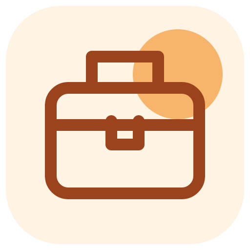

# Codex Toolkit

可獨立使用的 Python 工具、Codex Skills、Plugins 與 MCP 串接, 支援文件處理、Markdown 安全更新、程式碼盤點、工作規範與驗證證據整理

## 選擇使用方式

| 需求 | 入口 |
|---|---|
| 不使用 Codex, 直接執行工具 | [Python CLI](python-tools/README.md) |
| 在自己的 Python 程式使用核心 | [文件核心](python-tools/docs/python-document-core.md), [工作區核心](python-tools/docs/python-workspace-core.md) |
| 在 Codex 選用工作流程 | [Plugin 市集](docs/marketplace.md) 或 [獨立 Skills](docs/skills.md) |

MCP runtime、帳戶與用戶端註冊由安裝者自己的設定工具處理

[操作文件](docs/README.md) · [公開內容檢查](docs/public-content.md)

第一方程式碼與文件採 [MIT 授權](LICENSE), 第三方套件與素材見 [來源索引](docs/third-party.md)
